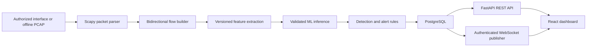

# Architecture

## Status

The ten planned implementation steps are complete. Packet ingestion, flow building, shared features, dataset/training tools, optional model inference, explainable alerts, SQLAlchemy persistence, Alembic migrations, authenticated REST APIs, role checks, audit records, authenticated alert delivery, a React dashboard, and local Compose deployment are implemented. On 2026-10-22, the Compose images built successfully, PostgreSQL reached healthy status, the API applied migrations through `0002_authentication`, and the dashboard and readiness endpoint returned HTTP 200. Real-data model evaluation and live capture remain unavailable or unverified.

## Target data flow

## Component boundaries

- **Capture and replay:** Convert packet layers to metadata. Payload capture is off by default. Offline replay is the portable, reproducible path; live capture is optional and requires explicit operator authorization and host support.
- **Flows:** Canonicalize endpoint pairs so both packet directions update one flow while preserving directional counters. Expire flows using configurable timeouts.
- **Features and ML:** Define one ordered, versioned feature schema for training and inference. Keep identifiers, labels, and target-derived values outside model input. Persist model provenance and evaluation results with the artifact.
- **Detection:** Keep model predictions separate from deterministic rules. Attach evidence, model/schema versions, severity, and review status to each alert.
- **Persistence and backend:** Store flows, detections, alerts, users, and operational events in PostgreSQL using SQLAlchemy and Alembic. Expose validated, paginated REST endpoints through FastAPI.
- **Realtime delivery:** Publish only after an alert is persisted. REST remains the source of historical truth; WebSockets provide timely updates.
- **Frontend:** Read actual API data and display honest empty, loading, disconnected, and error states. Demo fixtures, if introduced, must be clearly separated and labeled.

## Failure handling goals

Bound queues and flow state; make replay deterministic; report parser failures; keep model-unavailable status explicit while allowing independent rules; preserve persisted alerts when WebSocket clients disconnect; and report database unavailability as degraded readiness. Flow/model handling is implemented through Step 5. Step 6 adds database readiness and atomic-write failure reporting. Step 7 polls persisted alerts for authenticated socket clients and supports a timestamp/ID reconnect cursor. Step 8 provides authenticated browser views over persisted alerts and flows, filterable/paged REST reads, role-aware acknowledgement, and reconnecting stream status. Socket load is not stress-tested; clients reconnecting without a cursor receive only events created after their new connection starts.

## Implemented in Step 2

`nids_engine.packet` maps IPv4/IPv6 TCP, UDP, and ICMP packets (plus unknown/non-IP frames) into timezone-aware metadata. `nids_engine.capture` reads packets incrementally, counts parse/read/filter outcomes, and invokes a callback without retaining the packet list. `nids_engine.replay` exposes the CLI. The optional live adapter requires an explicit interface, uses `store=False`, and does not retain packet payloads. Controlled tests cover parser behavior and replay. Live capture remains unverified because this host lacks detected Npcap/libpcap support.

## Implemented in Step 3

`nids_engine.flows.FlowBuilder` canonicalizes bidirectional endpoint pairs, tracks directional packet/byte/size/TCP-flag statistics, expires idle and active flows using a monotonic event-time watermark, bounds active state and expiration-heap growth, and flushes remaining records deterministically. Packets without both IP endpoints remain separate one-packet flows instead of being assigned invented network identities. `nids_engine.features` emits the ordered numeric schema in [FEATURE_SCHEMA.md](FEATURE_SCHEMA.md), including explicit missing-value flags and compatibility validation.

## Implemented in Step 4

`ml.data.export_features` replays an authorized PCAP through the same flow and feature code and offers a blank flow-label template; labels are never inferred from predictions. `ml.data.loader` validates exact schema, finite values, provenance checksum, and labels, and removes exact duplicate feature/label rows. `ml.training.split` separates whole capture groups into train/validation/test. `ml.training.train` compares Logistic Regression and Random Forest, selects by validation macro-F1, evaluates the chosen model once on held-out groups, and writes a trusted-project artifact plus metadata and metrics. Real model availability remains blocked until real labeled captures are provided.

## Implemented in Step 5

`nids_engine.inference` validates model metadata, exact feature ordering, runtime versions, and the model file checksum before loading a project pipeline. Predictions contain the class and model/schema versions but no probability because the trained estimators are not calibrated. Missing or incompatible artifacts produce explicit unscored statuses. `nids_engine.detection` separates model-class alerts from transparent threshold heuristics, includes evidence and severity, and bounds duplicate-alert state. `nids_engine.monitor` connects offline PCAP replay to flows, features, optional inference, and JSON-line alerts. A missing model leaves heuristic alerts usable; a real trained model remains unavailable until labeled data is supplied.

## Implemented in Step 6

`backend.app.database.models` stores flows, one prediction per flow, and related alerts with UTC timestamps and query indexes. `database/migrations/versions/0001_persistence.py` creates the initial schema. The monitor can persist each flow/prediction/alert group in one transaction and stops on database errors before reporting that flow. Step 6 added liveness/readiness and paginated, filtered REST reads.

## Implemented in Step 7

`backend.app.security` uses Argon2id password hashes and HS256 JWTs with explicit issuer, audience, token type, expiry, and required claims. Access tokens expire after 15 minutes; refresh tokens are rotated, and the database stores only a one-way digest of each refresh `jti`. Refresh-token reuse revokes all active refresh sessions for that account. No public registration route exists; the first admin is created by `python -m backend.app.auth_admin` after migrations. REST data routes and the WebSocket require an active database user. Admins create users, analysts and admins acknowledge alerts, and all roles can read/stream. Audit records capture login, refresh, logout, account creation, and acknowledgement events without credentials. The WebSocket authenticates its first frame and polls persisted alerts so a separate monitor process can publish data without an in-process broker. SQLite test coverage passes; PostgreSQL migrations and service readiness were also verified in the local Compose deployment on 2026-10-22.
