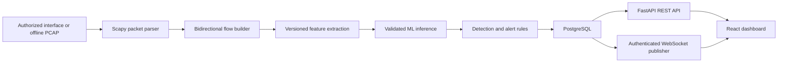

# Architecture

## Status

The full diagram is the planned architecture. As of Step 2, the packet metadata parser, streaming PCAP/PCAPNG replay, protocol filtering, and optional explicit-interface live capture adapter are implemented. Flow building, ML, persistence, backend, realtime delivery, and dashboard services remain planned.

## Target data flow

## Component boundaries

- **Capture and replay:** Convert packet layers to metadata. Payload capture is off by default. Offline replay is the portable, reproducible path; live capture is optional and requires explicit operator authorization and host support.
- **Flows:** Canonicalize endpoint pairs so both packet directions update one flow while preserving directional counters. Expire flows using configurable timeouts.
- **Features and ML:** Define one ordered, versioned feature schema for training and inference. Keep identifiers, labels, and target-derived values outside model input. Persist model provenance and evaluation results with the artifact.
- **Detection:** Keep model predictions separate from deterministic rules. Attach evidence, model/schema versions, severity, and review status to each alert.
- **Persistence and backend:** Store flows, detections, alerts, users, and operational events in PostgreSQL using SQLAlchemy and Alembic. Expose validated, paginated REST endpoints through FastAPI.
- **Realtime delivery:** Publish only after an alert is persisted. REST remains the source of historical truth; WebSockets provide timely updates.
- **Frontend:** Read actual API data and display honest empty, loading, disconnected, and error states. Demo fixtures, if introduced, must be clearly separated and labeled.

## Failure handling goals

Bound queues and flow state; make replay deterministic; report parser failures; handle missing models without fabricating detections; preserve persisted alerts when WebSocket clients disconnect; and report database unavailability as degraded readiness. These behaviors remain planned until implemented and tested.

## Implemented in Step 2

`nids_engine.packet` maps IPv4/IPv6 TCP, UDP, and ICMP packets (plus unknown/non-IP frames) into timezone-aware metadata. `nids_engine.capture` reads packets incrementally, counts parse/read/filter outcomes, and invokes a callback without retaining the packet list. `nids_engine.replay` exposes the CLI. The optional live adapter requires an explicit interface, uses `store=False`, and does not retain packet payloads. Controlled tests cover parser behavior and replay. Live capture remains unverified because this host lacks detected Npcap/libpcap support.

## Implemented in Step 3

`nids_engine.flows.FlowBuilder` canonicalizes bidirectional endpoint pairs, tracks directional packet/byte/size/TCP-flag statistics, expires idle and active flows using a monotonic event-time watermark, bounds active state and expiration-heap growth, and flushes remaining records deterministically. Packets without both IP endpoints remain separate one-packet flows instead of being assigned invented network identities. `nids_engine.features` emits the ordered numeric schema in [FEATURE_SCHEMA.md](FEATURE_SCHEMA.md), including explicit missing-value flags and compatibility validation.

## Implemented in Step 4

`ml.data.export_features` replays an authorized PCAP through the same flow and feature code and offers a blank flow-label template; labels are never inferred from predictions. `ml.data.loader` validates exact schema, finite values, provenance checksum, and labels, and removes exact duplicate feature/label rows. `ml.training.split` separates whole capture groups into train/validation/test. `ml.training.train` compares Logistic Regression and Random Forest, selects by validation macro-F1, evaluates the chosen model once on held-out groups, and writes a trusted-project artifact plus metadata and metrics. Real model availability remains blocked until real labeled captures are provided.
