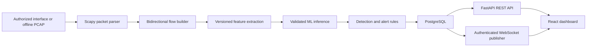

# Architecture

## Status

This is the planned architecture. As of Step 1, the repository contains documentation only; none of the processing or application services described below have been implemented.

## Target data flow

## Component boundaries

- **Capture and replay:** Convert packet layers to metadata. Payload capture is off by default. Offline replay is the portable, reproducible path; live capture is optional and requires explicit operator authorization and host support.
- **Flows:** Canonicalize endpoint pairs so both packet directions update one flow while preserving directional counters. Expire flows using configurable timeouts.
- **Features and ML:** Define one ordered, versioned feature schema for training and inference. Keep identifiers, labels, and target-derived values outside model input. Persist model provenance and evaluation results with the artifact.
- **Detection:** Keep model predictions separate from deterministic rules. Attach evidence, model/schema versions, severity, and review status to each alert.
- **Persistence and backend:** Store flows, detections, alerts, users, and operational events in PostgreSQL using SQLAlchemy and Alembic. Expose validated, paginated REST endpoints through FastAPI.
- **Realtime delivery:** Publish only after an alert is persisted. REST remains the source of historical truth; WebSockets provide timely updates.
- **Frontend:** Read actual API data and display honest empty, loading, disconnected, and error states. Demo fixtures, if introduced, must be clearly separated and labeled.

## Failure handling goals

Bound queues and flow state; make replay deterministic; report parser failures; handle missing models without fabricating detections; preserve persisted alerts when WebSocket clients disconnect; and report database unavailability as degraded readiness. These behaviors remain planned until implemented and tested.
