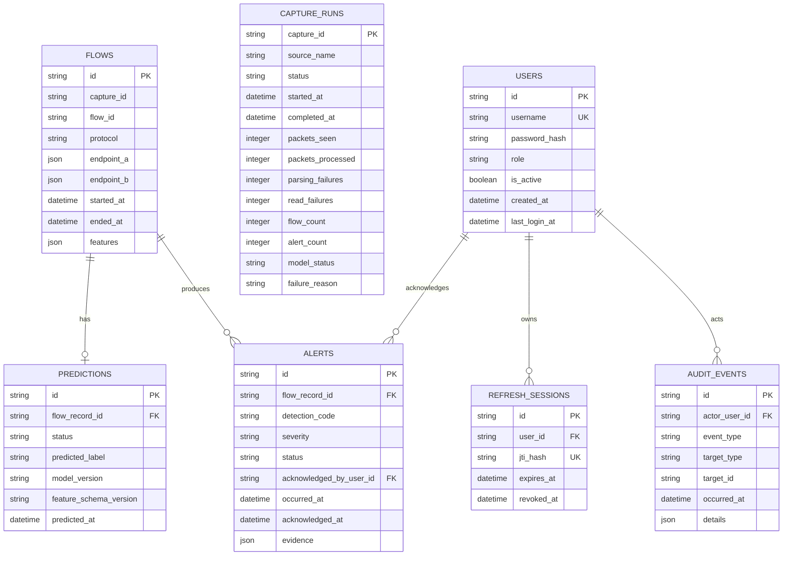

# Database design

## Current schema

The schema stores one row per finalized flow, one prediction result per flow, zero or more alerts per flow, capture-run summaries, user accounts, refresh sessions, and audit events. `capture_id` identifies a monitor run; `flow_id` is only unique within that run because the flow builder restarts its sequence for each capture. The capture-run and flow records share this identifier; the database leaves the relationship unenforced to preserve existing flow rows during migration.



All timestamps are stored as timezone-aware UTC values. The application normalizes SQLite's naive datetime round trips to UTC. Endpoint and evidence details use JSON columns; model features are the fixed ordered schema documented in [FEATURE_SCHEMA.md](FEATURE_SCHEMA.md). Indexes support time-ordered flow/alert pages and common protocol/severity/status filters. Deleting a flow cascades to its prediction and alerts; no delete API is exposed.

## Migration commands

Set `DATABASE_URL` to a PostgreSQL URL such as `postgresql+psycopg://nids:<password>@localhost:5432/nids_db`, then run:

```powershell
python -m alembic upgrade head
python -m alembic current
```

For an isolated local smoke test without PostgreSQL:

```powershell
$env:DATABASE_URL = "sqlite+pysqlite:///./nids.db"
python -m alembic upgrade head
```

The migrations create `flows`, `predictions`, `alerts`, `capture_runs`, `users`, `refresh_sessions`, `audit_events`, and Alembic's version table. Runtime code never calls `create_all`; schema changes belong in numbered Alembic revisions. After migration, provision the first administrator with `python -m backend.app.auth_admin --username admin`; password input is hidden. Later accounts are created by an authenticated administrator through the API.

PostgreSQL DDL was rendered successfully in offline migration mode. On 2026-10-23, a disposable PostgreSQL Compose project also applied migrations through `0003_capture_runs`; the PostgreSQL integration suite passed, and the isolated test volume was removed afterward.

## Persistence behavior

`nids_engine.monitor --database-url <URL>` stores each finalized flow, its prediction status, and its alerts in one transaction. The monitor writes no flow JSON to standard output until that transaction succeeds. A failed database write stops replay and reports the number of previously completed flows; it does not claim the failed observation was saved.

When a database URL is configured, the monitor writes a `capture_runs` row before reading the PCAP and updates it on completion, partial reads, or handled failure. It stores the source filename rather than the full local path, packet/flow/prediction/alert counts, model status/version, elapsed time, and a bounded failure code. A hard process termination can leave a run marked `running` with no completion time; later history views can show that state without inferring success.

The API reads the same persisted records. Login, refresh rotation, and logout use database-backed sessions; only a SHA-256 digest of each refresh-token `jti` is stored. Audit events contain event and target metadata, not credentials or tokens. Alert acknowledgement updates the alert and records its actor in one transaction. PostgreSQL connectivity, migration startup, and API readiness were verified in Compose; the more detailed API/authentication behavior remains covered by SQLite integration tests.
