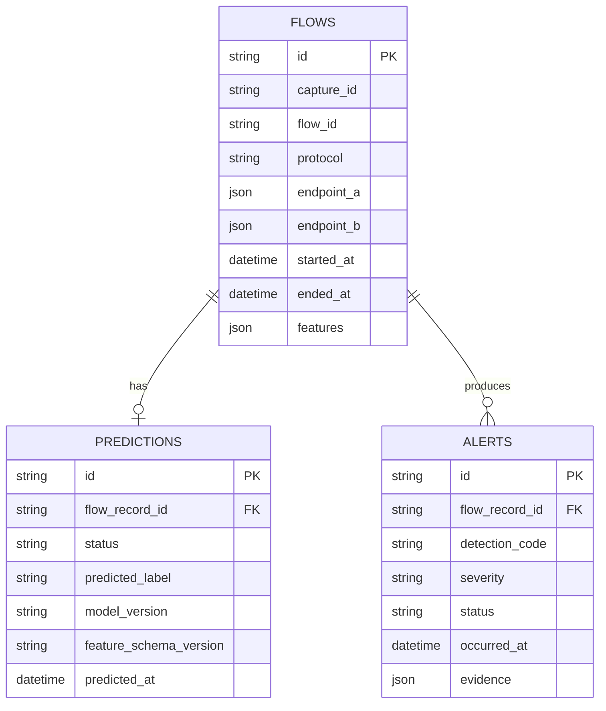

# Database design

## Current schema

The Step 6 schema stores one row per finalized flow, one prediction result per flow, and zero or more alerts per flow. `capture_id` identifies one monitor run; `flow_id` is only unique within that run because the flow builder restarts its sequence for each capture.



All timestamps are stored as timezone-aware UTC values. The application normalizes SQLite's naive datetime round trips to UTC. Endpoint and evidence details use JSON columns; model features are the fixed ordered schema documented in [FEATURE_SCHEMA.md](FEATURE_SCHEMA.md). Indexes support time-ordered flow/alert pages and common protocol/severity/status filters. Deleting a flow cascades to its prediction and alerts; no delete API is exposed.

## Migration commands

Set `DATABASE_URL` to a PostgreSQL URL such as `postgresql+psycopg://nids:<password>@localhost:5432/nids_db`, then run:

```powershell
python -m alembic upgrade head
python -m alembic current
```

For an isolated local smoke test without PostgreSQL:

```powershell
$env:DATABASE_URL = "sqlite+pysqlite:///./nids.db"
python -m alembic upgrade head
```

The migration creates `flows`, `predictions`, `alerts`, and Alembic's version table. Runtime code never calls `create_all`; schema changes belong in numbered Alembic revisions.

PostgreSQL DDL was rendered successfully in offline migration mode. This checks migration compilation against the PostgreSQL dialect but does not replace applying it to a live server.

## Persistence behavior

`nids_engine.monitor --database-url <URL>` stores each finalized flow, its prediction status, and its alerts in one transaction. The monitor writes no flow JSON to standard output until that transaction succeeds. A failed database write stops replay and reports the number of previously completed flows; it does not claim the failed observation was saved.

The API reads the same persisted records. No PostgreSQL server was available during Step 6, so migrations and API behavior were verified with SQLite; PostgreSQL connectivity and dialect integration remain untested.
